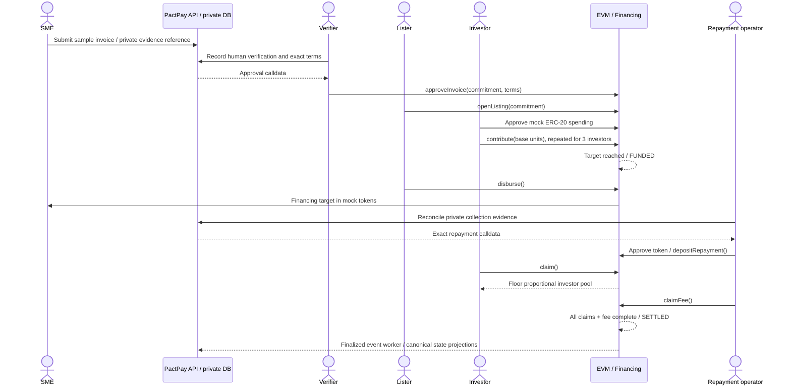

# Financing lifecycle

| Transition                 | Actor and conditions                                                    |
| -------------------------- | ----------------------------------------------------------------------- |
| NONE → APPROVED            | Verifier approves unique nonzero commitment and valid immutable terms   |
| APPROVED → OPEN            | Lister, allowlisted token, before funding deadline                      |
| OPEN → FUNDED              | Eligible contribution exactly completes target, before deadline         |
| OPEN/APPROVED → EXPIRED    | Anyone, at/after funding deadline; OPEN is necessarily under target     |
| FUNDED → EXPIRED           | Anyone, at/after maturity, if never disbursed                           |
| FUNDED → DISBURSED         | Lister, before maturity, exactly target sent to SME                     |
| DISBURSED → OVERDUE        | Anyone, at/after maturity; also derived automatically for reads         |
| DISBURSED/OVERDUE → REPAID | Settler transfers exact full obligation with unique evidence commitment |
| REPAID → SETTLED           | All positions claimed, dust returned and fixed platform fee paid        |

Refunds call expiry automatically where eligible and pay only the caller's own
contribution. Claims remain available without deadlines. Revoking investor status
or removing a token from the allowlist does not block existing liabilities' exits.
Pause blocks new risks while allowing expiry, refunds, repayment, claims and fees.
A fully funded offer can disburse after its funding deadline but before maturity.

There is no partial repayment or on-chain debt enforcement. Overdue is a status,
not a guaranteed future payment, default insurance or a write-off mechanism.
